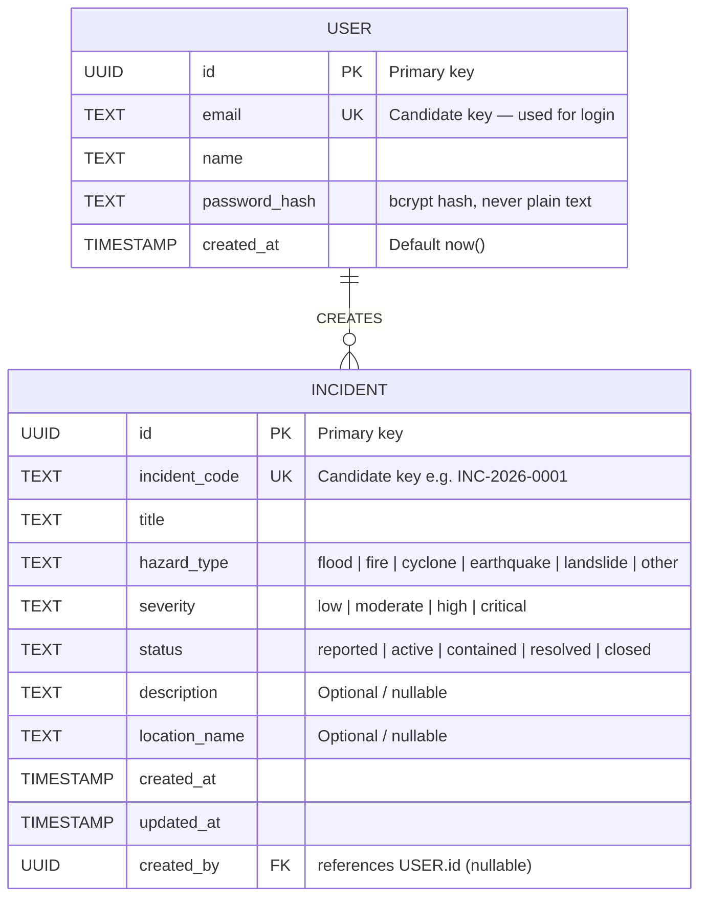

# 02 — ER Diagram (ResQGrid)

> Render this file in VS Code (install "Markdown Preview Mermaid Support" extension)
> or paste the mermaid block into https://mermaid.live

---

## Entity-Relationship Diagram



---

## Reading the Diagram

### Entities

| Entity | Meaning |
|---|---|
| **USER** | An admin or staff account that can log in and manage incidents |
| **INCIDENT** | A disaster or emergency event being tracked |

### Relationship: USER CREATES INCIDENT

```
USER  ||----o{  INCIDENT
      1          0..*
```

| Side | Notation | Participation | Meaning |
|---|---|---|---|
| USER | `\|\|` (exactly one) | Partial | A user may create zero or many incidents |
| INCIDENT | `o{` (zero or many) | Partial | An incident may or may not have a known creator (nullable FK) |

**Type:** Binary relationship (connects two entity types)

**Cardinality:** 1 : M — one user can create many incidents; each incident is created by at most one user

---

## Attributes Explained

### USER entity

| Attribute | Kind | Note |
|---|---|---|
| id | Simple, Key (PK) | Auto-generated UUID |
| email | Simple, Key (CK) | Candidate key — uniquely identifies a user |
| name | Simple | Display name |
| password_hash | Simple | Output of bcrypt — never the plain password |
| created_at | Simple | Set automatically on insert |

### INCIDENT entity

| Attribute | Kind | Note |
|---|---|---|
| id | Simple, Key (PK) | Auto-generated UUID |
| incident_code | Simple, Key (CK) | Human-readable unique code e.g. INC-2026-0001 |
| title | Simple | Short description of the event |
| hazard_type | Simple | One fixed value from the allowed set |
| severity | Simple | low / moderate / high / critical |
| status | Simple | Lifecycle: reported → active → resolved → closed |
| description | Simple (optional) | Nullable — may be NULL |
| location_name | Simple (optional) | Nullable — may be NULL |
| created_at | Simple | Auto-set on insert |
| updated_at | Simple | Auto-updated on every write |
| created_by | Simple, FK | References USER.id — may be NULL |

---

## Keys Summary

| Table | Primary Key | Candidate Keys | Foreign Key |
|---|---|---|---|
| users | id | {id}, {email} | — |
| incidents | id | {id}, {incident_code} | created_by → users.id |

---

## Relationship Participation (Crow's Foot)

```
USER        CREATES       INCIDENT
 |─────────────────────────|
 1          (1:M)         0..*

USER side:  partial participation  (a user need not have created any incident yet)
INCIDENT side: partial participation (created_by is nullable — no mandatory creator)
```
